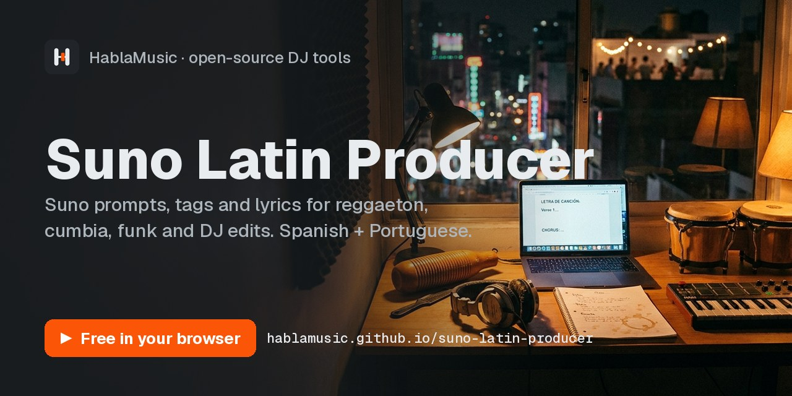

<a href="https://hablamusic.github.io/suno-latin-producer/es/"></a>

<div align="center">

[](LICENSE)
[](#pruébalo-tú-mismo)
[](#úsalo-desde-un-agente-de-ia)
[](https://hablamusic.com/?utm_source=github&utm_medium=readme-es&utm_campaign=suno-latin-producer)

**Prompts de Suno para reggaetón, dembow, cumbia, bachata, corridos y funk carioca: un prompt de estilo, etiquetas `[Verse]`/`[Chorus]` y letras revisadas sílaba por sílaba en español y portugués. Además, DJ edits con intros y outros limpios.**

**▶ [Pruébalo gratis en tu navegador](https://hablamusic.github.io/suno-latin-producer/es/)** · sin instalar nada, sin registrarte

[Empieza aquí](#empieza-aquí) · [Qué incluye](#qué-incluye) · [DJ edits](#dj-edits) · [Reglas de validación](#reglas-de-validación) · [Agentes](#úsalo-desde-un-agente-de-ia) · [Preguntas frecuentes](#preguntas-frecuentes)

</div>

[English](README.md) · Español · [Português (BR)](README.pt-BR.md)

# Suno Latin Producer: prompts de Suno y letras para música latina y DJs

Suno Latin Producer convierte una idea de una línea ("reggaetón para mi set, español, voz masculina") en las dos cosas que pide el editor de Suno: una línea de **Style** (género, BPM, tono, mood, instrumentos, producción, voz, idioma) y **Lyrics** estructuradas con etiquetas de sección (`[Intro]`, `[Verse]`, `[Chorus]`, `[Hook]`, `[Outro]`). Luego revisa la letra como lo haría un cantante: cuenta las **sílabas cantadas en español y portugués de Brasil** (diptongos, acentos y *sinalefa*, donde "te amo" son dos sílabas), marca la **rima consonante y asonante**, y valida las etiquetas para que Suno no cante la palabra "Chorus". El modo `--dj` crea **DJ edits**: intros y outros instrumentales perfectos para mezclar. Cubre 19 géneros latinos, brasileños y de club, además de los 20 generales. Gratis y de código abierto (MIT), creado por [HablaMusic](https://hablamusic.com/?utm_source=github&utm_medium=readme-es&utm_campaign=suno-latin-producer), basado en [uniqaiapp/suno-producer](https://github.com/uniqaiapp/suno-producer).

## Empieza aquí

| Eres | Haz esto | Tiempo |
|---|---|---|
| Nuevo en Suno, solo quieres un buen prompt | Abre la **[versión web](https://hablamusic.github.io/suno-latin-producer/es/)**, elige un género y mood, copia la línea de Style y la estructura de etiquetas en Suno | 1 minuto |
| Alguien que escribe sus propias letras | Pégalas en el **revisor** de la misma página: te muestra las sílabas por línea, el esquema de rimas y cualquier problema con las etiquetas | 2 minutos |
| Un DJ que necesita tracks para un set | Marca **DJ edit** en la web, o corre `python3 scripts/brief.py --genre dembow --lang es --dj` | 1 minuto |
| Usuario de Claude Code, Cursor o Codex | `npx skills add hablamusic/suno-latin-producer`, y luego pide "escríbeme un prompt de Suno para una cumbia sobre..." | 2 minutos |

Qué vas a ver: una línea de Style que pegas en la caja **Style** de Suno, una lista de etiquetas con la cantidad de líneas y sílabas que necesita cada sección, y, después de escribir la letra, un "clean" en verde o una lista de correcciones con números de línea.

## Pruébalo tú mismo

Python 3.9 o superior, sin instalar nada:

```bash
git clone https://github.com/hablamusic/suno-latin-producer
cd suno-latin-producer
python3 scripts/brief.py --genre reggaeton --mood playful --lang es --dj
python3 scripts/lyric_meter.py examples/lyrics/luna-de-neon.es.txt
python3 scripts/suno_lint.py examples/lyrics/luna-de-neon.es.txt --dj --style examples/style/luna-de-neon.es.txt
```

El primer comando imprime tres prompts de estilo que cambian en un solo detalle (para hacer pruebas A/B), una estructura `[Intro] … [Outro]` y un brief de letra en español. El segundo muestra las sílabas y rimas por línea de una canción de reggaetón de prueba. El tercero imprime `clean: 0 errors, 0 warnings`. `python3 scripts/brief.py --list` muestra todos los géneros, moods, voces y estructuras.

## Qué incluye



| **Brief de entrada, prompt de salida** | **Sílabas cantadas, ES + PT + EN** | **Valida antes de gastar créditos** |
|:---|:---|:---|
| `brief.py` convierte "cumbia, cálido, español" en una línea de Style con dos variantes de un solo eje, una estructura con etiquetas y objetivos de sílabas por sección en tu idioma. | `lyric_meter.py` cuenta las sílabas tal como se cantan (diptongos, hiatos, acentos, sinalefa/elisão), saca el esquema de rimas (consonante = completa, asonante = parcial) y marca las líneas que se desvían. | `suno_lint.py` revisa la ortografía y el orden de las etiquetas, la longitud de las secciones, los límites de caracteres, las frases que imitan artistas en tres idiomas y, con `--dj`, la regla para DJ edits. Código de salida 1 si hay errores. |

Salida real de la canción de prueba (`examples/outputs/luna-de-neon.meter.txt`):

```text
[Hook]         4 lines · syllables 5-12 · scheme Aaaa
   1  10  Luna de neón, prende la ciudad               A
   2  10  Baila sin razón, nadie va a mirar            a
   3  12  Luna de neón, quédate un poquito más         a
   4   5  (un poquito más)                             a
[Verse 2]      4 lines · syllables 11-12 · scheme AABB
   1  11  Dos de la mañana y nadie quiere irse         A
   2  11  El DJ baja el tempo para despedirse          A
   3  12  Tu sombra en la pared dibuja una canción     B
   4  11  Y el piso se mueve con el corazón            B
```

`canción` / `corazón` es una rima consonante (B mayúscula); `ciudad` / `mirar` / `más` solo comparten la vocal, una asonancia (a minúscula). La línea de apoyo `(un poquito más)` queda exenta de la revisión de longitud.

### Géneros

| Latinos | Brasileños | Club (para mezclar) |
|---|---|---|
| reggaeton, dembow, latin trap, latin pop, cumbia, bachata, salsa, merengue, corridos tumbados, moombahton, guaracha | funk carioca, brazilian phonk, piseiro, sertanejo, pagode | latin house, tech house, afro house, amapiano, house, techno, drum and bass |

Cada uno tiene un rango de tempo, tonos típicos, instrumentos, palabras de producción y una estructura por defecto en [`references/genres.json`](references/genres.json) (CC BY 4.0). Son puntos de partida editoriales, no mediciones exactas: revisa un track de referencia con el [Buscador de BPM y tono](https://hablamusic.github.io/bpm-key-finder/es/) y sobrescribe los valores con `--bpm` y `--key`.

## DJ edits

Un track que puedas mezclar necesita compases sin voz al principio y al final. `--dj` los pide y verifica que estén ahí:

```bash
python3 scripts/brief.py --genre "funk carioca" --mood euphoric --lang pt --dj
python3 scripts/suno_lint.py lyrics.txt --dj
```

El prompt de estilo recibe `extended instrumental intro, extended instrumental outro, DJ-friendly arrangement`; el brief de letra te dice que dejes `[Intro]` y `[Outro]` vacíos; el validador te avisa (`L017`) si faltan o si tienen líneas cantadas. Para elegir un tono que encaje en tu set, usa la [Rueda de Camelot](https://hablamusic.github.io/camelot-wheel/es/). Los modelos de música con IA siguen el tempo que pides mucho más que el tono: en 19 tracks, el BPM coincidió con el prompt 18 veces y el tono solo una ([datos](https://github.com/hablamusic/bpm-key-finder#accuracy-tested-on-19-ai-generated-tracks)), así que mide el resultado antes de etiquetarlo.

## Reglas de validación

| Id | Nivel | Revisión |
|---|---|---|
| L001 | warn | Etiqueta que no está en la lista conocida (`references/section-tags.md`); el modelo podría cantarla |
| L002 | warn | Letra antes de la primera etiqueta, o ninguna etiqueta en absoluto |
| L003 | warn | Falta `[Chorus]`, `[Hook]` o `[Drop]` (sáltalo con `--instrumental`) |
| L004 | warn | La misma etiqueta dos veces seguidas |
| L005 | warn | `[Intro]` no es la primera o `[Outro]` no es la última |
| L006 | error / warn | `[ ]` desbalanceados (error) o `( )` desbalanceados (warn) en una línea |
| L007 | error | Frase que imita a un artista ("in the style of", "al estilo de", "no estilo de", "в стиле") |
| L008 | error / warn | Prompt de estilo supera el límite (`--max-style`, por defecto 1000) / está vacío |
| L009 | error | La letra supera el límite (`--max-lyrics`, por defecto 5000) |
| L010 | warn | Una etiqueta dentro de una línea de letra |
| L011 | warn | Sección más larga que `--max-section-lines` (por defecto 12) |
| L012 | warn | `[Tags]` en el prompt de estilo |
| L013 | warn | Prompt de estilo repartido en más de tres líneas |
| L014 | warn | Etiqueta en minúsculas |
| L015 | info | No hay tempo en el prompt de estilo |
| L016 | warn | Una sección de letra sin líneas (las etiquetas instrumentales están exentas) |
| L017 | warn | Con `--dj`: falta `[Intro]` al principio / `[Outro]` al final, o tienen líneas cantadas |

Los límites son los valores por defecto; el editor de Suno muestra el límite real junto a cada campo.

## Úsalo desde un agente de IA

El repo es una skill para agentes: [`SKILL.md`](SKILL.md) le dice al agente cómo aclarar el brief, correr los tres scripts y entregar Style + Lyrics + variantes.

```bash
npx skills add hablamusic/suno-latin-producer                                   # any agent, via the skills CLI
git clone https://github.com/hablamusic/suno-latin-producer ~/.claude/skills/suno-latin-producer   # Claude Code
```

Cursor: copia `SKILL.md`, `scripts/`, `references/` y [`.cursor/rules/suno-latin-producer.mdc`](.cursor/rules/suno-latin-producer.mdc). Codex o cualquier agente de `AGENTS.md`: mira [`codex/INSTRUCTIONS.md`](codex/INSTRUCTIONS.md). O pega `SKILL.md` en cualquier modelo de chat.

## Ejemplos

Cada salida en `examples/outputs/` se reproduce byte por byte con `python3 tests/run.py`; [`examples/README.md`](examples/README.md) lista los comandos.

- `luna-de-neon.es.txt`: DJ edit de reggaetón en español, limpio con `--dj`.
- `baile-na-laje.pt.txt`: DJ edit de funk carioca brasileño, limpio con `--dj`.
- `midnight-bus.txt`: canción de synthwave en inglés; `--dj` marca su outro cantado.
- `bad-tags.txt`: un archivo roto que activa casi todas las reglas (salida 1).

## Límites y honestidad

- El conteo de sílabas sigue reglas ortográficas, no un diccionario. El español y el portugués coinciden con una frase cantada en nuestros ejemplos; los extranjerismos y nombres ("DJ", "reggaetón") pueden fallar por una sílaba. El inglés suele estar a una sílaba de distancia del conteo de diccionario.
- La rima en español y portugués se busca desde la vocal tónica según las reglas de acentuación; no conoce la pronunciación regional (seseo, la -e final brasileña).
- Los scripts nunca llaman a Suno. Eliminan causas conocidas de malas generaciones; no pueden prometer una buena. No estamos afiliados a Suno.
- No se incluyen letras con derechos de autor, y el validador rechaza el "al estilo de" un artista.

## Preguntas frecuentes

<details>
<summary><b>¿Cómo escribo un prompt de Suno para reggaetón?</b></summary>

Pon el género primero, luego el tempo y el tono, dos palabras de mood, dos o tres instrumentos, una palabra de producción, la voz y el idioma, todo en una sola línea: `reggaeton, 94 BPM, F minor, playful, bouncy, dembow drums, deep 808 bass, sub-heavy club mix, warm male vocal, Spanish-language vocals`. `brief.py --genre reggaeton --lang es` lo escribe por ti, con dos variantes para comparar.

</details>

<details>
<summary><b>¿Las etiquetas de Suno deben estar en español o portugués?</b></summary>

No. Mantén las etiquetas en inglés (`[Chorus]`, no `[Coro]` ni `[Refrão]`): el modelo reconoce las etiquetas en inglés como estructura y podría cantar una traducida. La letra en sí se queda en tu idioma.

</details>

<details>
<summary><b>¿Por qué Suno acelera algunas de mis líneas?</b></summary>

Porque son más largas que las demás en la sección. Mantén cada línea a una diferencia máxima de unas dos sílabas cantadas del resto; `lyric_meter.py` muestra los conteos y te avisa si te desvías. En español y portugués cuenta como cantas: "te amo" son dos sílabas.

</details>

<details>
<summary><b>¿Cómo hago un track de IA que un DJ pueda mezclar?</b></summary>

Pide un intro y outro instrumentales en la línea de Style, deja `[Intro]` y `[Outro]` vacíos en la letra, y elige un tempo y tono que encajen en tu set. `--dj` hace las dos primeras cosas y las verifica. Luego confirma el BPM y tono reales con el [Buscador de BPM y tono](https://hablamusic.github.io/bpm-key-finder/es/).

</details>

<details>
<summary><b>¿En qué se diferencia de suno-producer?</b></summary>

[suno-producer](https://github.com/uniqaiapp/suno-producer) de UniqAI es la base, con métrica en inglés y ruso. Esta edición suma el conteo y rima en español y portugués, 19 géneros latinos, brasileños y de club, DJ edits y una versión web.

</details>

## Más herramientas gratis para DJs

- [Buscador de BPM y tono](https://github.com/hablamusic/bpm-key-finder): BPM, tono y código Camelot para canciones y carpetas enteras, en el navegador o la terminal.
- [Rueda de Camelot](https://github.com/hablamusic/camelot-wheel): qué se mezcla con qué, conversor de tonos, comprobación de mashups.
- [Prompts de IA para DJs](https://github.com/hablamusic/awesome-ai-dj-prompts): prompts probados para intros, outros y bases para remixes.
- Guías en hablamusic.com: [Prompts de Suno](https://hablamusic.com/learn/suno-prompts?utm_source=github&utm_medium=readme-es&utm_campaign=suno-latin-producer), [Meta etiquetas de Suno](https://hablamusic.com/learn/suno-meta-tags?utm_source=github&utm_medium=readme-es&utm_campaign=suno-latin-producer), [reggaetón con IA](https://hablamusic.com/es/genres/reggaeton?utm_source=github&utm_medium=readme-es&utm_campaign=suno-latin-producer).

## Autor

Creado por Vlad Yasinski: [roimobi.com](https://www.roimobi.com/?utm_source=github&utm_medium=readme-es&utm_campaign=suno-latin-producer) · [LinkedIn](https://www.linkedin.com/in/vlad-yasinski-ua5er/).

## Licencia

Código y skill: [MIT](LICENSE). Datos de géneros y referencias en `references/`: CC BY 4.0 (atribución: UniqAI y HablaMusic). Basado en [uniqaiapp/suno-producer](https://github.com/uniqaiapp/suno-producer).

---

<div align="center"><sub>Creado por <a href="https://hablamusic.com/?utm_source=github&utm_medium=readme-es&utm_campaign=suno-latin-producer">HablaMusic</a>: generador de música con IA y herramientas gratis para DJs en inglés, español y portugués.</sub></div>
