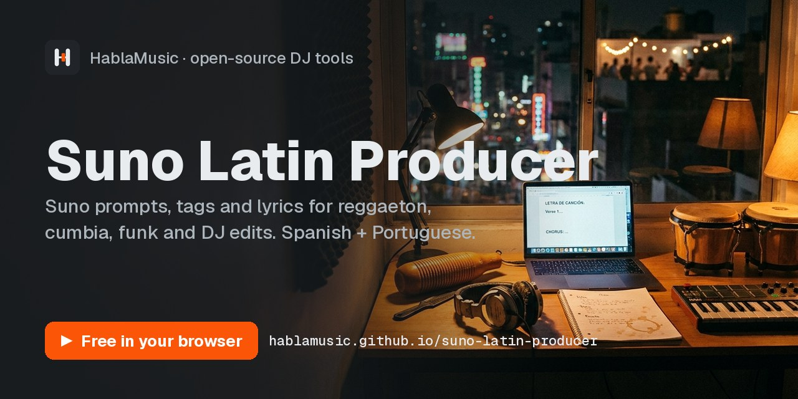

<a href="https://hablamusic.github.io/suno-latin-producer/"></a>

<div align="center">

[](LICENSE)
[](#run-it-yourself)
[](#use-it-from-an-ai-agent)
[](https://hablamusic.com/?utm_source=github&utm_medium=readme&utm_campaign=suno-latin-producer)

**Suno prompts for reggaeton, dembow, cumbia, bachata, corridos and funk carioca: a style prompt, `[Verse]`/`[Chorus]` tags, and lyrics checked syllable by syllable in Spanish and Portuguese. Plus DJ edits with clean intros and outros.**

**▶ [Try it free in your browser](https://hablamusic.github.io/suno-latin-producer/)** · no install, no sign-up

[Start here](#start-here) · [What you get](#what-you-get) · [DJ edits](#dj-edits) · [Lint rules](#lint-rules) · [Agents](#use-it-from-an-ai-agent) · [FAQ](#faq)

</div>

English · [Español](README.es.md) · [Português (BR)](README.pt-BR.md)

# Suno Latin Producer: Suno prompts and lyrics for Latin music and DJs

Suno Latin Producer turns a one-line idea ("reggaeton for my set, Spanish, male vocal") into the two things the Suno editor asks for: a **Style** line (genre, BPM, key, mood, instruments, production, vocal, language) and **Lyrics** laid out with section tags (`[Intro]`, `[Verse]`, `[Chorus]`, `[Hook]`, `[Outro]`). Then it checks the lyrics the way a singer would: it counts **sung syllables in Spanish and Brazilian Portuguese** (diphthongs, accents, and *sinalefa*, where "te amo" is two syllables), marks **consonant rhyme and assonance**, and lints the tags so Suno does not sing the word "Chorus". A `--dj` mode makes **DJ edits**: instrumental intros and outros you can beatmatch. It covers 19 Latin, Brazilian and club genres on top of the 20 general ones. Free and open source (MIT), from [HablaMusic](https://hablamusic.com/?utm_source=github&utm_medium=readme&utm_campaign=suno-latin-producer), based on [uniqaiapp/suno-producer](https://github.com/uniqaiapp/suno-producer).

## Start here

| You are | Do this | Time |
|---|---|---|
| New to Suno, just want a good prompt | Open the **[browser version](https://hablamusic.github.io/suno-latin-producer/)**, pick a genre and mood, copy the Style line and the tag layout into Suno | 1 minute |
| Writing your own lyrics | Paste them into the **checker** on the same page: it shows syllables per line, the rhyme scheme and every tag problem | 2 minutes |
| A DJ who needs tracks for a set | Tick **DJ edit** in the browser, or run `python3 scripts/brief.py --genre dembow --lang es --dj` | 1 minute |
| Using Claude Code, Cursor or Codex | `npx skills add hablamusic/suno-latin-producer`, then ask "write me a Suno prompt for a cumbia about…" | 2 minutes |

What you'll see: a Style line you paste into Suno's **Style** box, a list of tags with how many lines and syllables each section needs, and, after you write the words, a green "clean" or a list of fixes with line numbers.

## Run it yourself

Python 3.9 or newer, nothing to install:

```bash
git clone https://github.com/hablamusic/suno-latin-producer
cd suno-latin-producer
python3 scripts/brief.py --genre reggaeton --mood playful --lang es --dj
python3 scripts/lyric_meter.py examples/lyrics/luna-de-neon.es.txt
python3 scripts/suno_lint.py examples/lyrics/luna-de-neon.es.txt --dj --style examples/style/luna-de-neon.es.txt
```

The first command prints three style prompts that differ in one thing each (A/B test them), a `[Intro] … [Outro]` structure and a lyric brief in Spanish. The second prints syllables and rhyme per line of a sample reggaeton song. The third prints `clean: 0 errors, 0 warnings`. `python3 scripts/brief.py --list` shows every genre, mood, vocal and structure.

## What you get



| **Brief in, prompt out** | **Sung syllables, ES + PT + EN** | **Lint before you spend credits** |
|:---|:---|:---|
| `brief.py` turns "cumbia, warm, Spanish" into a Style line with two one-axis variants, a tagged structure and per-section syllable targets in your language. | `lyric_meter.py` counts syllables the way they are sung (diphthongs, hiatus, accents, sinalefa/elisão), derives the rhyme scheme (consonant = full, assonance = slant) and flags lines that drift. | `suno_lint.py` checks tag spelling and order, section length, field budgets, artist-imitation phrases in three languages and, with `--dj`, the DJ-edit rule. Exit code 1 on errors. |

Real output on the sample song (`examples/outputs/luna-de-neon.meter.txt`):

```text
[Hook]         4 lines · syllables 5-12 · scheme Aaaa
   1  10  Luna de neón, prende la ciudad               A
   2  10  Baila sin razón, nadie va a mirar            a
   3  12  Luna de neón, quédate un poquito más         a
   4   5  (un poquito más)                             a
[Verse 2]      4 lines · syllables 11-12 · scheme AABB
   1  11  Dos de la mañana y nadie quiere irse         A
   2  11  El DJ baja el tempo para despedirse          A
   3  12  Tu sombra en la pared dibuja una canción     B
   4  11  Y el piso se mueve con el corazón            B
```

`canción` / `corazón` is a full rhyme (uppercase B); `ciudad` / `mirar` / `más` share only the vowel, an assonance (lowercase a). The `(un poquito más)` backing line is exempt from the length check.

### Genres

| Latin | Brazilian | Club (for mixing) |
|---|---|---|
| reggaeton, dembow, latin trap, latin pop, cumbia, bachata, salsa, merengue, corridos tumbados, moombahton, guaracha | funk carioca, brazilian phonk, piseiro, sertanejo, pagode | latin house, tech house, afro house, amapiano, house, techno, drum and bass |

Each has a tempo range, typical keys, instruments, production words and a default structure in [`references/genres.json`](references/genres.json) (CC BY 4.0). They are editorial starting points, not measurements: check a reference track with the [BPM and key finder](https://hablamusic.github.io/bpm-key-finder/) and override with `--bpm` and `--key`.

## DJ edits

A track you can mix needs bars with no vocal at both ends. `--dj` asks for them and checks for them:

```bash
python3 scripts/brief.py --genre "funk carioca" --mood euphoric --lang pt --dj
python3 scripts/suno_lint.py lyrics.txt --dj
```

The style prompt gets `extended instrumental intro, extended instrumental outro, DJ-friendly arrangement`; the lyric brief tells you to leave `[Intro]` and `[Outro]` empty; the lint warns (`L017`) if they are missing or have sung lines. To pick a key that fits your set, use the [Camelot wheel](https://hablamusic.github.io/camelot-wheel/). AI music models follow the tempo you ask for far more often than the key: on 19 tracks the BPM matched the prompt 18 times and the key once ([data](https://github.com/hablamusic/bpm-key-finder#accuracy-tested-on-19-ai-generated-tracks)), so measure the result before you tag it.

## Lint rules

| Id | Level | Check |
|---|---|---|
| L001 | warn | Tag not in the known list (`references/section-tags.md`); the model may sing it |
| L002 | warn | Lyrics before the first tag, or no tags at all |
| L003 | warn | No `[Chorus]`, `[Hook]` or `[Drop]` (skip with `--instrumental`) |
| L004 | warn | The same tag twice in a row |
| L005 | warn | `[Intro]` not first or `[Outro]` not last |
| L006 | error / warn | Unbalanced `[ ]` (error) or `( )` (warn) on a line |
| L007 | error | Artist-imitation phrase ("in the style of", "al estilo de", "no estilo de", "в стиле") |
| L008 | error / warn | Style prompt over budget (`--max-style`, default 1000) / empty |
| L009 | error | Lyrics over budget (`--max-lyrics`, default 5000) |
| L010 | warn | A tag inside a lyric line |
| L011 | warn | Section longer than `--max-section-lines` (default 12) |
| L012 | warn | `[Tags]` in the style prompt |
| L013 | warn | Style prompt spread over more than three lines |
| L014 | warn | Lower-case tag |
| L015 | info | No tempo in the style prompt |
| L016 | warn | A lyric section with no lines (instrumental tags are exempt) |
| L017 | warn | With `--dj`: no `[Intro]` first / `[Outro]` last, or sung lines in them |

Budgets are defaults; the Suno editor shows the live limit next to each field.

## Use it from an AI agent

The repo is an agent skill: [`SKILL.md`](SKILL.md) tells the agent how to clarify the brief, run the three scripts and deliver Style + Lyrics + variants.

```bash
npx skills add hablamusic/suno-latin-producer                                   # any agent, via the skills CLI
git clone https://github.com/hablamusic/suno-latin-producer ~/.claude/skills/suno-latin-producer   # Claude Code
```

Cursor: copy `SKILL.md`, `scripts/`, `references/` and [`.cursor/rules/suno-latin-producer.mdc`](.cursor/rules/suno-latin-producer.mdc). Codex or any `AGENTS.md` agent: see [`codex/INSTRUCTIONS.md`](codex/INSTRUCTIONS.md). Or paste `SKILL.md` into any chat model.

## Examples

Every output under `examples/outputs/` is reproduced byte for byte by `python3 tests/run.py`; [`examples/README.md`](examples/README.md) lists the commands.

- `luna-de-neon.es.txt`: Spanish reggaeton DJ edit, clean under `--dj`.
- `baile-na-laje.pt.txt`: Brazilian funk carioca DJ edit, clean under `--dj`.
- `midnight-bus.txt`: English synthwave song; `--dj` flags its sung outro.
- `bad-tags.txt`: a broken file that trips most rules (exit 1).

## Limits and honesty

- Syllable counts follow spelling rules, not a dictionary. Spanish and Portuguese match a sung phrase in our examples; loanwords and names ("DJ", "reggaetón") can be one off. English is usually within one of a dictionary count.
- Rhyme in Spanish and Portuguese is found from the stressed vowel by the accent rules; it does not know regional pronunciation (seseo, Brazilian final -e).
- The scripts never call Suno. They remove known causes of bad generations; they cannot promise a good one. Not affiliated with Suno.
- No copyrighted lyrics are included, and the lint rejects "in the style of" an artist.

## FAQ

<details>
<summary><b>How do I write a Suno prompt for reggaeton?</b></summary>

Put the genre first, then tempo and key, two mood words, two or three instruments, one production word, the vocal and the language, all on one line: `reggaeton, 94 BPM, F minor, playful, bouncy, dembow drums, deep 808 bass, sub-heavy club mix, warm male vocal, Spanish-language vocals`. `brief.py --genre reggaeton --lang es` writes it for you, with two variants to compare.

</details>

<details>
<summary><b>Should the Suno tags be in Spanish or Portuguese?</b></summary>

No. Keep tags in English (`[Chorus]`, not `[Coro]` or `[Refrão]`): the model knows the English tags as structure and may sing a translated one. The lyrics themselves stay in your language.

</details>

<details>
<summary><b>Why does Suno rush some of my lines?</b></summary>

They are longer than the others in the section. Keep every line within about two sung syllables of the rest; `lyric_meter.py` shows the counts and warns on drift. In Spanish and Portuguese count the way you sing: "te amo" is two syllables.

</details>

<details>
<summary><b>How do I make an AI track a DJ can mix?</b></summary>

Ask for instrumental intro and outro in the Style line, leave `[Intro]` and `[Outro]` empty in the lyrics, and choose a tempo and key that fit your set. `--dj` does the first two and checks them. Then confirm the real BPM and key with the [BPM and key finder](https://hablamusic.github.io/bpm-key-finder/).

</details>

<details>
<summary><b>How is this different from suno-producer?</b></summary>

[suno-producer](https://github.com/uniqaiapp/suno-producer) by UniqAI is the base, with English and Russian meter. This edition adds Spanish and Portuguese counting and rhyme, 19 Latin, Brazilian and club genres, DJ edits, and a browser version.

</details>

## More free DJ tools

- [BPM and key finder](https://github.com/hablamusic/bpm-key-finder): BPM, key and Camelot code for songs and whole folders, in the browser or the terminal.
- [Camelot wheel](https://github.com/hablamusic/camelot-wheel): what mixes with what, key converter, mashup check.
- [AI DJ prompts](https://github.com/hablamusic/awesome-ai-dj-prompts): tested prompts for intros, outros and remix beds.
- Guides on hablamusic.com: [Suno prompts](https://hablamusic.com/learn/suno-prompts?utm_source=github&utm_medium=readme&utm_campaign=suno-latin-producer), [Suno meta tags](https://hablamusic.com/learn/suno-meta-tags?utm_source=github&utm_medium=readme&utm_campaign=suno-latin-producer), [reggaeton with AI](https://hablamusic.com/genres/reggaeton?utm_source=github&utm_medium=readme&utm_campaign=suno-latin-producer).

## Author

Built by Vlad Yasinski: [roimobi.com](https://www.roimobi.com/?utm_source=github&utm_medium=readme&utm_campaign=suno-latin-producer) · [LinkedIn](https://www.linkedin.com/in/vlad-yasinski-ua5er/).

## License

Code and skill: [MIT](LICENSE). Genre data and references in `references/`: CC BY 4.0 (attribution: UniqAI and HablaMusic). Based on [uniqaiapp/suno-producer](https://github.com/uniqaiapp/suno-producer).

---

<div align="center"><sub>Made by <a href="https://hablamusic.com/?utm_source=github&utm_medium=readme&utm_campaign=suno-latin-producer">HablaMusic</a>: AI music generator and free DJ tools in English, Spanish and Portuguese.</sub></div>
