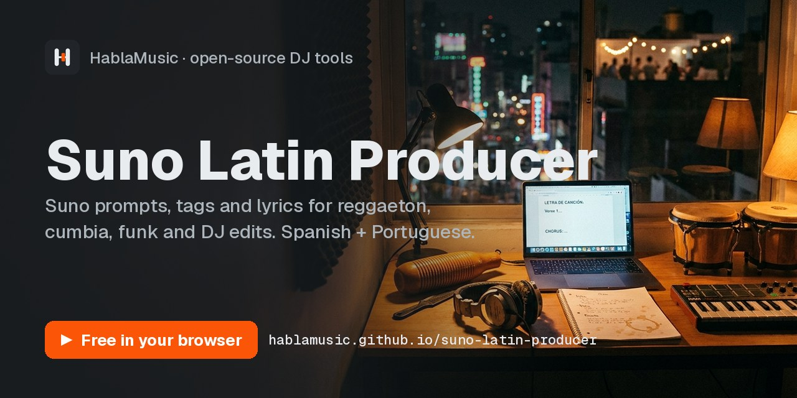

<a href="https://hablamusic.github.io/suno-latin-producer/pt/"></a>

<div align="center">

[](LICENSE)
[](#rode-você-mesmo)
[](#use-com-um-agente-de-ia)
[](https://hablamusic.com/?utm_source=github&utm_medium=readme-pt&utm_campaign=suno-latin-producer)

**Prompts do Suno para reggaeton, dembow, cumbia, bachata, corridos e funk carioca: um prompt de estilo, tags como `[Verse]`/`[Chorus]` e letras checadas sílaba por sílaba em espanhol e português. Além de DJ edits com intros e outros limpos.**

**▶ [Teste grátis no seu navegador](https://hablamusic.github.io/suno-latin-producer/pt/)** · sem instalar nada, sem cadastro

[Comece aqui](#comece-aqui) · [O que você recebe](#o-que-você-recebe) · [DJ edits](#dj-edits) · [Regras de lint](#regras-de-lint) · [Agentes](#use-com-um-agente-de-ia) · [FAQ](#faq)

</div>

[English](README.md) · [Español](README.es.md) · Português (BR)

# Suno Latin Producer: Prompts do Suno e letras para música latina e DJs

O Suno Latin Producer transforma uma ideia simples ("reggaeton pro meu set, espanhol, voz masculina") nas duas coisas que o editor do Suno pede: uma linha de **Style** (gênero, BPM, tom, vibe, instrumentos, produção, voz, idioma) e **Lyrics** organizadas com tags de seção (`[Intro]`, `[Verse]`, `[Chorus]`, `[Hook]`, `[Outro]`). Depois, ele checa a letra como um cantor faria. Ele conta as **sílabas cantadas em espanhol e português do Brasil** (ditongos, acentos e *elisão/sinalefa*, onde "te amo" vira duas sílabas). Ele marca **rimas consoantes e toantes**. E faz o lint das tags pro Suno não cantar a palavra "Chorus". O modo `--dj` cria **DJ edits**: intros e outros instrumentais perfeitos pra mixar. Cobre 19 gêneros latinos, brasileiros e de club, além dos 20 gerais. Grátis e open source (MIT), da [HablaMusic](https://hablamusic.com/?utm_source=github&utm_medium=readme-pt&utm_campaign=suno-latin-producer), baseado no [uniqaiapp/suno-producer](https://github.com/uniqaiapp/suno-producer).

## Comece aqui

| Você é | Faça isso | Tempo |
|---|---|---|
| Novo no Suno, só quer um bom prompt | Abra a **[versão de navegador](https://hablamusic.github.io/suno-latin-producer/pt/)**, escolha um gênero e uma vibe, copie a linha de Style e a estrutura de tags pro Suno | 1 minuto |
| Escrevendo suas próprias letras | Cole tudo no **checker** na mesma página. Ele mostra as sílabas por linha, o esquema de rimas e qualquer problema nas tags | 2 minutos |
| Um DJ precisando de tracks pro set | Marque **DJ edit** no navegador, ou rode `python3 scripts/brief.py --genre dembow --lang es --dj` | 1 minuto |
| Usando Claude Code, Cursor ou Codex | Rode `npx skills add hablamusic/suno-latin-producer` e peça "escreva um prompt do Suno para uma cumbia sobre..." | 2 minutos |

O que você vai ver: uma linha de Style pra colar na caixa **Style** do Suno. Uma lista de tags com o número de linhas e sílabas que cada seção precisa. E, depois de escrever a letra, um "clean" verde ou uma lista de correções com o número das linhas.

## Rode você mesmo

Python 3.9 ou superior, nada pra instalar:

```bash
git clone https://github.com/hablamusic/suno-latin-producer
cd suno-latin-producer
python3 scripts/brief.py --genre reggaeton --mood playful --lang es --dj
python3 scripts/lyric_meter.py examples/lyrics/luna-de-neon.es.txt
python3 scripts/suno_lint.py examples/lyrics/luna-de-neon.es.txt --dj --style examples/style/luna-de-neon.es.txt
```

O primeiro comando gera três prompts de estilo com uma diferença entre eles (faça um teste A/B). Ele também cria uma estrutura `[Intro] … [Outro]` e um briefing de letra em espanhol. O segundo mostra as sílabas e rimas por linha de um reggaeton de exemplo. O terceiro exibe `clean: 0 errors, 0 warnings`. O comando `python3 scripts/brief.py --list` mostra todos os gêneros, vibes, vocais e estruturas.

## O que você recebe



| **Entra briefing, sai prompt** | **Sílabas cantadas, ES + PT + EN** | **Lint antes de gastar créditos** |
|:---|:---|:---|
| O `brief.py` transforma "cumbia, warm, Spanish" numa linha de Style com duas variações. Ele também entrega uma estrutura com tags e metas de sílabas por seção no seu idioma. | O `lyric_meter.py` conta as sílabas do jeito que são cantadas (ditongos, hiatos, acentos, sinalefa/elisão). Ele descobre o esquema de rimas (consoante = perfeita, toante = imperfeita) e avisa se alguma linha sair do padrão. | O `suno_lint.py` checa a escrita e a ordem das tags, o tamanho das seções e os limites de caracteres. Ele barra frases que imitam artistas em três idiomas e, com `--dj`, valida a regra de DJ edit. Retorna exit code 1 em caso de erro. |

Saída real da música de exemplo (`examples/outputs/luna-de-neon.meter.txt`):

```text
[Hook]         4 lines · syllables 5-12 · scheme Aaaa
   1  10  Luna de neón, prende la ciudad               A
   2  10  Baila sin razón, nadie va a mirar            a
   3  12  Luna de neón, quédate un poquito más         a
   4   5  (un poquito más)                             a
[Verse 2]      4 lines · syllables 11-12 · scheme AABB
   1  11  Dos de la mañana y nadie quiere irse         A
   2  11  El DJ baja el tempo para despedirse          A
   3  12  Tu sombra en la pared dibuja una canción     B
   4  11  Y el piso se mueve con el corazón            B
```

`canción` / `corazón` é uma rima perfeita (B maiúsculo). Já `ciudad` / `mirar` / `más` dividem só a vogal, uma rima toante (a minúsculo). A linha de apoio `(un poquito más)` fica de fora da checagem de tamanho.

### Gêneros

| Latinos | Brasileiros | Club (pra mixar) |
|---|---|---|
| reggaeton, dembow, latin trap, latin pop, cumbia, bachata, salsa, merengue, corridos tumbados, moombahton, guaracha | funk carioca, brazilian phonk, piseiro, sertanejo, pagode | latin house, tech house, afro house, amapiano, house, techno, drum and bass |

Cada um tem uma faixa de BPM, tons típicos, instrumentos, termos de produção e uma estrutura padrão no [`references/genres.json`](references/genres.json) (CC BY 4.0). São pontos de partida editoriais, não medições exatas. Cheque uma track de referência com o [BPM and key finder](https://hablamusic.github.io/bpm-key-finder/pt/) e mude os valores com `--bpm` e `--key`.

## DJ edits

Uma track boa pra mixar precisa de compassos sem voz no começo e no fim. A flag `--dj` pede isso no prompt e checa se você fez certo:

```bash
python3 scripts/brief.py --genre "funk carioca" --mood euphoric --lang pt --dj
python3 scripts/suno_lint.py lyrics.txt --dj
```

O prompt de estilo ganha `extended instrumental intro, extended instrumental outro, DJ-friendly arrangement`. O briefing da letra avisa pra deixar `[Intro]` e `[Outro]` vazios. O lint dá um aviso (`L017`) se eles faltarem ou tiverem linhas cantadas. Pra escolher um tom que encaixe no seu set, use a [Roda de Camelot](https://hablamusic.github.io/camelot-wheel/pt/). Modelos de IA seguem o BPM que você pede com muito mais frequência do que o tom. Em 19 tracks, o BPM bateu com o prompt 18 vezes, mas o tom só uma ([dados](https://github.com/hablamusic/bpm-key-finder#accuracy-tested-on-19-ai-generated-tracks)). Então, meça o resultado antes de colocar as tags no arquivo.

## Regras de lint

| Id | Nível | Checagem |
|---|---|---|
| L001 | warn | Tag fora da lista conhecida (`references/section-tags.md`); o modelo pode cantá-la |
| L002 | warn | Letra antes da primeira tag, ou nenhuma tag |
| L003 | warn | Sem `[Chorus]`, `[Hook]` ou `[Drop]` (ignore com `--instrumental`) |
| L004 | warn | A mesma tag duas vezes seguidas |
| L005 | warn | `[Intro]` não é a primeira ou `[Outro]` não é a última |
| L006 | error / warn | `[ ]` (error) ou `( )` (warn) sem fechar na linha |
| L007 | error | Frase imitando artista ("in the style of", "al estilo de", "no estilo de", "в стиле") |
| L008 | error / warn | Prompt de estilo passou do limite (`--max-style`, padrão 1000) / vazio |
| L009 | error | Letra passou do limite (`--max-lyrics`, padrão 5000) |
| L010 | warn | Uma tag no meio da linha da letra |
| L011 | warn | Seção maior que `--max-section-lines` (padrão 12) |
| L012 | warn | `[Tags]` no prompt de estilo |
| L013 | warn | Prompt de estilo espalhado em mais de três linhas |
| L014 | warn | Tag em letras minúsculas |
| L015 | info | Sem andamento (BPM) no prompt de estilo |
| L016 | warn | Seção de letra sem linhas (tags instrumentais são isentas) |
| L017 | warn | Com `--dj`: sem `[Intro]` no começo / `[Outro]` no final, ou com linhas cantadas neles |

Os limites são os padrões. O editor do Suno mostra o limite real do lado de cada campo.

## Use com um agente de IA

O repo funciona como uma skill de agente. O [`SKILL.md`](SKILL.md) ensina o agente a refinar o briefing, rodar os três scripts e entregar Style + Lyrics + variações.

```bash
npx skills add hablamusic/suno-latin-producer                                   # any agent, via the skills CLI
git clone https://github.com/hablamusic/suno-latin-producer ~/.claude/skills/suno-latin-producer   # Claude Code
```

Cursor: copie `SKILL.md`, `scripts/`, `references/` e [`.cursor/rules/suno-latin-producer.mdc`](.cursor/rules/suno-latin-producer.mdc). Codex ou qualquer agente do `AGENTS.md`: veja [`codex/INSTRUCTIONS.md`](codex/INSTRUCTIONS.md). Ou simplesmente cole o `SKILL.md` em qualquer modelo de chat.

## Exemplos

Cada saída na pasta `examples/outputs/` é reproduzida byte a byte pelo `python3 tests/run.py`. O arquivo [`examples/README.md`](examples/README.md) lista os comandos.

- `luna-de-neon.es.txt`: DJ edit de reggaeton em espanhol, passa limpo no `--dj`.
- `baile-na-laje.pt.txt`: DJ edit de funk carioca, passa limpo no `--dj`.
- `midnight-bus.txt`: Música synthwave em inglês. O `--dj` aponta erro no outro cantado.
- `bad-tags.txt`: Um arquivo quebrado que aciona quase todas as regras (exit 1).

## Limites e transparência

- A contagem de sílabas segue regras gramaticais, não um dicionário. Espanhol e português batem com a frase cantada nos nossos exemplos. Palavras estrangeiras e nomes ("DJ", "reggaetón") podem errar por uma sílaba. O inglês costuma ficar a uma sílaba de distância da contagem de dicionário.
- As rimas em espanhol e português são achadas a partir da vogal tônica pelas regras de acentuação. O script não entende sotaques regionais (seseo, o "-e" final no Brasil).
- Os scripts nunca chamam a API do Suno. Eles removem causas conhecidas de gerações ruins, mas não garantem uma track perfeita. Não temos afiliação com o Suno.
- Nenhuma letra com direitos autorais está inclusa. O lint rejeita prompts com "no estilo de" um artista.

## FAQ

<details>
<summary><b>Como eu escrevo um prompt do Suno pra reggaeton?</b></summary>

Coloque o gênero primeiro. Depois o BPM e o tom, duas palavras de vibe, dois ou três instrumentos, um termo de produção, o vocal e o idioma. Tudo na mesma linha: `reggaeton, 94 BPM, F minor, playful, bouncy, dembow drums, deep 808 bass, sub-heavy club mix, warm male vocal, Spanish-language vocals`. O comando `brief.py --genre reggaeton --lang es` escreve isso pra você, com duas variações pra comparar.

</details>

<details>
<summary><b>As tags do Suno devem ser em espanhol ou português?</b></summary>

Não. Mantenha as tags em inglês (`[Chorus]`, não `[Coro]` ou `[Refrão]`). O modelo entende as tags em inglês como estrutura e pode acabar cantando se você traduzir. A letra em si continua no seu idioma.

</details>

<details>
<summary><b>Por que o Suno acelera algumas das minhas linhas?</b></summary>

Elas são mais longas que as outras na mesma seção. Mantenha cada linha com uma diferença máxima de duas sílabas cantadas em relação ao resto. O `lyric_meter.py` mostra as contagens e avisa se sair do padrão. Em espanhol e português, conte do jeito que você canta: "te amo" são duas sílabas.

</details>

<details>
<summary><b>Como eu faço uma track de IA que um DJ consiga mixar?</b></summary>

Peça intro e outro instrumentais na linha de Style. Deixe `[Intro]` e `[Outro]` vazios na letra. Escolha um BPM e tom que encaixem no seu set. A flag `--dj` faz as duas primeiras coisas e checa pra você. Depois, confirme o BPM e o tom reais com o [BPM and key finder](https://hablamusic.github.io/bpm-key-finder/pt/).

</details>

<details>
<summary><b>Qual a diferença disso pro suno-producer?</b></summary>

O [suno-producer](https://github.com/uniqaiapp/suno-producer) da UniqAI é a base, com métrica em inglês e russo. Essa edição adiciona contagem e rimas em espanhol e português. Traz 19 gêneros latinos, brasileiros e de club, DJ edits e uma versão de navegador.

</details>

## Mais ferramentas grátis pra DJs

- [BPM and key finder](https://github.com/hablamusic/bpm-key-finder): BPM, tom e código Camelot pra músicas e pastas inteiras, no navegador ou terminal.
- [Roda de Camelot](https://github.com/hablamusic/camelot-wheel): o que mixa com o que, conversor de tom, checagem de mashups.
- [Prompts de IA pra DJs](https://github.com/hablamusic/awesome-ai-dj-prompts): prompts testados pra intros, outros e bases de remix.
- Guias na hablamusic.com: [Prompts do Suno](https://hablamusic.com/learn/suno-prompts?utm_source=github&utm_medium=readme-pt&utm_campaign=suno-latin-producer), [Meta tags do Suno](https://hablamusic.com/learn/suno-meta-tags?utm_source=github&utm_medium=readme-pt&utm_campaign=suno-latin-producer), [reggaeton com IA](https://hablamusic.com/pt/genres/reggaeton?utm_source=github&utm_medium=readme-pt&utm_campaign=suno-latin-producer).

## Autor

Criado por Vlad Yasinski: [roimobi.com](https://www.roimobi.com/?utm_source=github&utm_medium=readme-pt&utm_campaign=suno-latin-producer) · [LinkedIn](https://www.linkedin.com/in/vlad-yasinski-ua5er/).

## Licença

Código e skill: [MIT](LICENSE). Dados de gêneros e referências em `references/`: CC BY 4.0 (atribuição: UniqAI e HablaMusic). Baseado no [uniqaiapp/suno-producer](https://github.com/uniqaiapp/suno-producer).

---

<div align="center"><sub>Feito pela <a href="https://hablamusic.com/?utm_source=github&utm_medium=readme-pt&utm_campaign=suno-latin-producer">HablaMusic</a>: Gerador de música com IA e ferramentas grátis pra DJs em inglês, espanhol e português.</sub></div>
